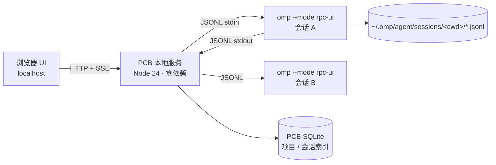

# PCB — 本地壳可行性评估（omp 18.22.0 / RPC）

> 评估对象：`D:\developer\PCB`（当时为空目录，从零开始）
> 评估环境：omp v18.22.0、Node v24.16.0、npm 11.13.0、无 bun
> 评估方式：读 `oh-my-pi` 源码与 `docs/rpc.md`，并用真实子进程跑通 RPC 全流程（探测脚本已删除）

---

## 1. 结论

**能做。** RPC 面足够宽，足以支撑“对话 / 计划 / 动手”全部由 omp 自己执行，壳只做监督与翻译。

但有 4 个真实缺口，其中**计划模式**是唯一必须由产品层兜住的（RPC 不可驱动），其余是可用性与工程成本问题。

---

## 2. 已实测证据

启动方式：`omp --mode rpc-ui --no-session --approval-mode always-ask`

### 2.1 握手与传输

```json
{"type":"ready","protocolVersion":1,"supportedProtocolVersions":[1,2],
 "maxFrameBytes":1048576,"maxReassembledFrameBytes":67108864,
 "supportsBashExcludeFromContext":true}
```

- 自定义 JSONL 协议，**不是** JSON-RPC 2.0；一帧一行 JSON。
- v1 单帧上限 1 MiB；协商 `negotiate_protocol:2` 后超大对象改走 `rpc_chunk`（base64 分片），重组上限 64 MiB。
- 未知命令、解析失败、处理异常都回 `type:"response"` + `id` 关联；`bash`、`predict_word` 等命令并发派发，**必须按 `id` 匹配，不能按到达顺序**。

### 2.2 完整回合帧序（实测）

```
ready
available_commands_update
response:negotiate_protocol / get_state / set_ask_dialog / prompt
agent_start
turn_start
message_start → message_update × N → message_end        (assistant 工具调用)
tool_execution_start → tool_execution_update × N → tool_execution_end
turn_start → message_start → message_update × N → message_end
turn_end
agent_end
prompt_result  {"id":"pr1","agentInvoked":true,"status":"completed","sessionSettled":true}
session_settled
```

注意：`session_settled` 之后进程**不会**自动退出（stdin 仍打开）。壳自己负责生命周期。

### 2.3 审批确实走 RPC（关键）

`--approval-mode always-ask` 下，模型调用 `bash` 时收到：

```json
{"type":"extension_ui_request","id":"15d11238ae5652da","method":"select",
 "title":"Allow tool: bash\nCommand: echo pcb-probe",
 "options":["Approve","Approve bash for this session","Deny"]}
```

回 `{"type":"extension_ui_response","id":"...","value":"Approve"}` 后工具才执行。**壳可以直接把它渲染成按钮卡片。**

### 2.4 斜杠命令的分野（决定了“计划”怎么做）

| 输入 | 结果 | 说明 |
| --- | --- | --- |
| `/model` | `command_output: "Current model: deepseek/deepseek-v4-flash-vision-exp"`，无 `agent_start` | 本地消费 |
| `/plan` | 无本地处理，直接 `agent_start` | 被当普通文本转发给模型 |

源码对应：`slash-commands/builtin-modes.ts:285` 的 `/plan` 只有 `handleTui`；RPC 侧 `modes/rpc/rpc-mode.ts:1934` 调 `executeAcpBuiltinSlashCommand`，对 TUI-only 条目返回 `false`（`slash-commands/acp-builtins.ts:53-58` 注释明说），于是原样转发。

### 2.5 本机可用的资源面

- `get_available_commands`：53 个内置命令（`model/switch/fast/slow/effort/advisor/tools/mcp/compact/handoff/memory/session/…`）。
- `get_available_models`：69 个模型（当前默认 `deepseek/deepseek-v4-flash-vision-exp`）。
- `get_login_providers`：带 `available` / `authenticated` 标记（本机 `zai`、`zai-coding-plan` 已认证）。
- `get_state` 返回键：`model, thinkingLevel, isStreaming, isCompacting, isSettled, todoPhases, queuedMessages, queuedMessageCount, hasPendingAsyncWork, contextUsage, tokensPerSecond, goal, sessionId, systemPrompt, dumpTools, …`

---

## 3. 可用面 → 壳的 UI 映射

对话层不需要自造：所有“看起来像聊天”的东西都由 omp 的帧驱动。

| 用户看到 / 操作 | 走的通道 |
| --- | --- |
| 发言、流式输出 | `prompt`；`agent_start…agent_end`；可 `set_event_filter` 开 `messageUpdates:"delta"` 节省带宽 |
| 停止 | `abort`（`abort_and_prompt` = 先停再发） |
| 追加插话 / 排队 | `steer`、`follow_up`、`remove_queued_message`、`promote_queued_message`；UI 用 `queue_update` 事件，不要自己维护队列 |
| 审批卡片 | `extension_ui_request: select` → `extension_ui_response { value }` |
| AI 反问用户（结构化） | `set_ask_dialog {enabled:true}` 后 `ask`：`questions[{id,question,options[{label,description}],multi,recommended}]` → `answers[{id,selectedOptions,customInput}]` |
| 计划 / 进度面板 | `get_state.todoPhases` + todo 事件；壳也可用 `set_todos` 反推计划 |
| 模型 / 思考档位 | `get_available_models`、`set_model`、`cycle_model`、`set_thinking_level` |
| 历史浏览、回退、分支 | `get_messages_page`（分页、`session_busy`/`stale_cursor` 错误码）、`get_tree`、`branch`、`fork`、`navigate_tree` |
| 子代理可视化 | `set_subagent_subscription: progress\|events` → `subagent_lifecycle/progress/event` |
| 状态条 / 通知 / 小部件 | `session_info_update`、`config_update`、`setStatus`、`notify`、`setWidget` |
| 分享 / 导出 | `export_html` |
| 壳自身能力给 AI 用 | `set_host_tools`（执行权在壳，agent 只是发起） |
| 会话锁检查 | `get_session_lease`（或 `omp session lease -- <id>`） |

---

## 4. 缺口与风险

| # | 事实（含出处） | 影响 | 处理方案 |
| --- | --- | --- | --- |
| 1 | 计划模式 RPC 不可驱动：`/plan` 只有 `handleTui`（`builtin-modes.ts:285`）；RPC 走 `executeAcpBuiltinSlashCommand`（`rpc-mode.ts:1934`），TUI-only 返回 `false` 后原文转发；扩展 API `sessionModes` 在 RPC 下为 `undefined`（`docs/extensions.md:365`）；`xd://propose` 的审批弹窗只在 TUI | 没有官方的“先出计划、我批准再动手”闸门 | 壳自建两阶段：只读提示词产出计划 → 壳的批准按钮 → 用户同意后才放开写/执行；`--plan-yolo` 是自动批准，不能用 |
| 2 | 审批是「纯文本标题 + 英文选项标签」，无结构化字段（`tools/approval.ts: approvalChoiceLabels`） | 只能按标签映射成 允许 / 本会话允许 / 拒绝；标签变化即失效 | 白名单映射 + 未知标签兜底为“拒绝”；原文标题直接展示（含 `Command:`、`Reason:` 行） |
| 3 | 密钥类登录不支持：`secret:true` 的提示一律拒绝并指向终端（`docs/rpc.md` Login 节） | 非程序员无法在壳里填 API Key | 壳只做“是否已登录”检测（`authenticated`）+ OAuth `open_url`；API Key 给 `omp login` 引导 |
| 4 | 无 Node 可用的官方客户端：SDK 要求 Bun ≥1.4.4（`docs/sdk.md`），本机无 bun；npm 包 `exports.import` 指向 `.ts` 源码，且含 `with { type: "text" }` 导入（`agent-session.ts:209`），Node 无法加载 | 必须自写客户端 | 自写 ~300–400 行：行分帧、v2 协商 + `rpc_chunk` 重组、`id` 关联、对话框应答；用 `rpc-wire.schema.json` 做回归校验 |
| 5 | 本机 `tools.approvalMode` 默认 `yolo`（`docs/approval-mode.md` 模式表） | 非程序员场景下 AI 直接跑命令 | 壳必须显式传 `--approval-mode write` 或 `always-ask-cached` |
| 6 | `--mode rpc-ui` 自动设 `PI_NO_PTY=1` | 交互式命令（密码、TUI 程序）跑不了 | 明示“需要交互的命令请在终端执行”；或不承诺支持 |
| 7 | 当前配置激活了 `autoresearch` 扩展：探测跑完在会话 cwd 写出了 `research/io/*.txt`（内容含用户原始提问） | 用户项目里凭空多文件，且泄露提示词 | `--no-extensions`，或每项目显式扩展白名单 |
| 8 | 会话按 cwd 分桶：`~/.omp/agent/sessions/<encoded-cwd>/*.jsonl` | 多项目列表要自己扫盘或自建索引 | 壳用 SQLite 维护 项目↔会话 索引，展示时再读会话头 |

---

## 5. 建议架构



设计要点：

1. **一会话一进程**：`omp --cwd <项目> --mode rpc-ui --approval-mode write`。进程即会话边界；崩溃后用 `--restore` 续跑 omp 自己记录的“未完成回合 + 子代理”。
2. **壳是监督者 + 翻译层**：帧 → 视图模型（对话 / 活动卡片 / 计划 / 弹窗），不实现任何 agent 逻辑，也不包裹一层“假对话”。
3. **恢复前查锁**：`get_session_lease`，避免与终端里开着的同一会话互相踩。
4. **先做本地 HTTP + 浏览器壳**（无打包、无构建链），交互定型后再考虑 Tauri/Electron 套壳。

模块边界（初稿）：

```
pcb/
  server/         HTTP + SSE，静态资源，鉴权（仅 loopback）
  rpc/            client.ts(帧/关联/v2重组)  protocol.ts(类型)  dialog.ts(审批与 ask)
  supervisor/     session.ts(子进程生命周期) registry.ts(项目↔会话) lease.ts
  viewmodel/      transcript.ts  activity.ts  plan.ts  status.ts
  web/            渲染层
```

---

## 6. 分期

| 阶段 | 产出 | 验收 |
| --- | --- | --- |
| P0 | RPC 客户端 + 子进程监督 + 一个“回声”页面 | 能发一句话、看到流式输出、看到 `prompt_result`/`session_settled` |
| P1 | 对话 UI：消息、工具活动卡片、停止、插话 | 一次真实多步操作全程可见、可中断 |
| P2 | 审批卡片 + `ask` 弹窗 + 模型选择 + 登录状态 | 审批走按钮，AI 反问走结构化表单 |
| P3 | 计划两阶段、会话列表/恢复、导出 | 计划批准前无写操作发生 |
| P4 | 打包、崩溃恢复、扩展白名单 | 双击可用的本地壳 |

---

## 7. 待决策（开工前需要拍板）

1. **形态**：先浏览器（`127.0.0.1` 打开即用）还是直接桌面应用？
2. **UI 技术**：原生 TS + DOM（零依赖）还是 React + Vite（构建链多一层）？
3. **审批默认档**：`write`（改文件不问、跑命令要问）还是 `always-ask-cached`（读文件也问、可记住授权）？
4. **计划做法**：壳自建两阶段（只读出计划 → 按钮批准 → 执行），还是接受 `--plan-yolo` 自动批准？

建议默认：浏览器壳 / 原生 TS + DOM / `write` / 壳自建两阶段。
